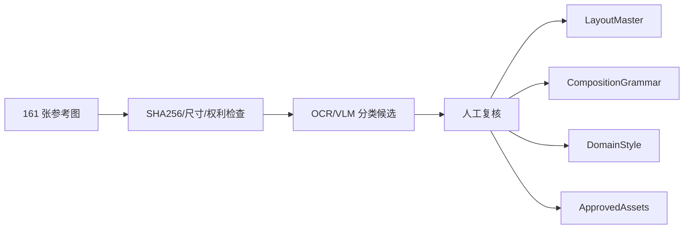
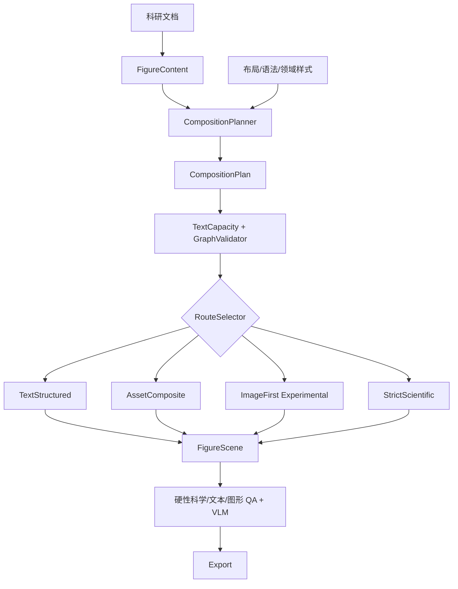

# 架构边界与责任合同

## 离线设计资源

## 在线科研图生产

## 责任原则

- 原始研究来源不受构图、参考图片影响；
- 版式意图不复制论文素材和科学结论；
- 文本层只读批准 LabelInstance；
- 关键边只读已审核 Relation；
- 图像只负责获准的对象插画/装饰，直接生图路径保留审核未通过状态；
- AssetIndex 只有人工许可审核通过才允许生产；
- 任何软视觉评判不能通过不正确的科学硬门禁；
- 官方 PPT Master 图文版式主要是参考思想，不要求直接移植复杂 PowerPoint 和 OOXML 模块。

## 推荐流程

第一次请求用 `analysis_only` 返回 FigureContent 和设计建议；确认/自动规则通过后进入 `preview`；通过 QA 后 `export`。如果科学来源不足，则 `blocked_content`，并提供缺口列表。复杂高密度文本可以显示一个结构预览，但不得误称已通过科学与视觉终审。
